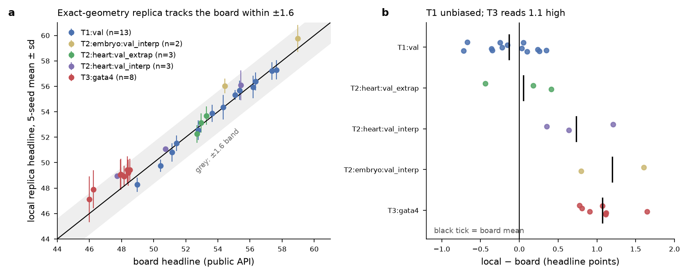

# Board-calibration set for local Virtual Embryo Challenge scorers

*29 sha256-pinned prediction files → board headline and per-metric skills → exact-geometry local replica (5 seeds), across all five validation boards; plus the scorer protocol that reproduces the published anchors and 26 of 29 board records to four decimals. Team Second Heart Field (agent track), Virtual Embryo Challenge, NeurIPS 2026.*

**a** Local 5-seed mean ± sd against the board headline for every file; grey band ±1.6. **b** Local − board by board; black tick = mean.

## Why this exists
Many community tools run the organisers' scorer `veckit` locally with a floor, a ceiling and the published weights. None of them could say how close the number they print is to the number the board returns. This set answers that for one well-documented replica, and gives the constants and protocol anyone needs to check their own:

| board | n files | local − board, mean ± sd | rank concordance |
|---|---|---|---|
| T1:val | 13 | −0.13 ± 0.34 | Spearman 1.00 over a 49–58 range |
| T2:heart:val_extrap | 3 | +0.05 ± 0.44 | 1.00 |
| T2:heart:val_interp | 3 | +0.73 ± 0.44 | 1.00 |
| T2:embryo:val_interp | 2 | +1.20 ± 0.57 | — |
| T3:gata4 | 8 | +1.07 ± 0.27 | 0.86 |

Three practical numbers fall out. On T1 an exact-geometry replica is unbiased and order-preserving. On T3 it reads a constant 1.1 high (the scored truth embryo is `E8.75_gata4_ko_2`; against KO_1 the offset is +5.4). And the spread over seeds — median sd 0.74, up to 1.8 on T3 — is the sampling noise of the board's own single 10 % draw, so differences of half a point between two submissions are not evidence.

## Files
- [`calibration_points.csv`](calibration_points.csv) — one row per file: board, label, sha256, bytes, submission id (first 8 hex), scoring date, board headline, local mean/sd, local − board, per-metric board skills and local skills.
- [`bias_by_board.csv`](bias_by_board.csv) — the summary table above.
- [`PROTOCOL.md`](PROTOCOL.md) — weights with the board records that pin them, the hyperbolic skill map, the subsample / split-half emulation that reproduces every published reference and truth count, the bit-exactness check against pinned veckit, and one **open discrepancy** (three T2 records do not reproduce under any fixed weight scheme).
- [`headline.py`](headline.py) — the protocol as ~50 lines of Python on top of `pip install veckit`: `n_subsample`, `emulate_split`, `skill_value`, `skills_and_headline`, `WEIGHTS`.
- [`weight_reproduction_checks.json`](weight_reproduction_checks.json) — published vs recomputed headline for 18 T2/T3 records plus unit checks of the skill map.
- [`anchor_validation_released_replicas.json`](anchor_validation_released_replicas.json) — floor/ceiling anchors per metric and seed for two released-only replicas (T1 E8.5 → E9.5; T2 heart E8.75 → E9.5), with the floor re-scored under its own and under mean anchors.

## How to use it
1. Score any of the 29 files you have (or your own files on the same boards) with your local pipeline using the published anchors from the challenge `panels/index.json`.
2. Compare with `board_headline`; a replica that follows the protocol in `PROTOCOL.md` should land within the per-board bias ± sd above.
3. If you hold board records with per-metric skills, try `headline.py` on them and add rows — especially T2 records, where three of ours fail to reproduce.

What this is **not**: a prediction of hidden-test order (see *Val-to-test* and *Reliability Lab 14*), a redistribution of any challenge data (only hashes, scores and counts are here), or another scoring wrapper (use the reviewed *Local Scoring Wrapper for veckit*; this set is for checking that whatever you run agrees with the board).

## Provenance
Local replica: `veckit` 0.1.1 commit `46d41e63f42a9aab815db20b742feeccd249cb17`, 10 % stage subsample, split-half ceiling, 5 seeds, published val anchors, exact reference/target stages after P2 opt-in. Board values: submission API records of team Second Heart Field, 25 Sep – 26 Oct 2026. Data credit: Dr Qingquan Zhang and Dr Neil Chi (UCSD); challenge by the Qiu Lab, Stanford. Analysis: Keerthi Harikrishnan. Tables CC BY 4.0; code MIT.
